# Schéma relationnel — base `suivi_patient`

MySQL 8, 10 tables, généré par Sequelize (`sequelize.sync({ alter: true })` dans
[`config/init.js`](config/init.js)). Il n'y a pas de fichiers de migration : le
schéma ci-dessous est la projection des modèles de [`models/`](models/).

## Vue d'ensemble


Version vectorielle (zoom sans perte, pour un poster ou une impression) :
[`docs/schema-bdd.svg`](docs/schema-bdd.svg) · version haute densité :
[`docs/schema-bdd@2x.png`](docs/schema-bdd@2x.png).

Les colonnes sur fond ambre référencent `users.id` **sans contrainte en base** —
voir [Limites connues](#limites-connues).

## Le même schéma en Mermaid

Utile pour un diff lisible en revue de code : contrairement à l'image, ce bloc
se relit ligne à ligne dans une pull request.

```mermaid
erDiagram
    users ||--o{ users : "treatingDoctorId (médecin traitant)"
    users ||--o{ appointments : "patientId"
    users ||--o{ medications : "patientId"
    users ||--o{ symptoms : "patientId"
    users ||--o{ thyroid_checkins : "patientId"
    users ||--o{ documents : "patientId"
    users ||--o{ chat_messages : "patientId"
    users ||--o{ notifications : "patientId"
    users ||--o{ apple_health_measurements : "patientId"
    users ||--o{ messages : "patientId / doctorId / senderId"

    users {
        varchar id PK
        varchar email UK "unique, identifiant de connexion"
        varchar password "hash bcrypt"
        enum role "patient | doctor"
        varchar doctorReferralCode UK "code de parrainage, médecins"
        varchar treatingDoctorId FK "-> users.id, patients"
        enum registrationStatus "approved | pending | rejected"
        datetime approvedAt
        varchar approvedByDoctorId "pas de contrainte FK"
        tinyint isEmailVerified
        varchar emailVerificationToken
        datetime emailVerifiedAt
        json profile "firstName, lastName, diagnosis, ..."
        datetime createdAt
        datetime updatedAt
    }

    appointments {
        varchar id PK
        varchar patientId FK "-> users.id"
        varchar doctorId "pas de contrainte FK"
        varchar title
        text description
        datetime date
        varchar time
        varchar location
        varchar type
        enum status "upcoming | completed | cancelled | pending"
    }

    medications {
        varchar id PK
        varchar patientId FK "-> users.id"
        varchar name
        varchar dosage
        varchar frequency
        json times "heures de prise"
        datetime startDate
        datetime endDate
        varchar indication
        varchar prescribedBy
        text instructions
        int stock
        varchar color
    }

    symptoms {
        varchar id PK
        varchar patientId FK "-> users.id"
        datetime date
        varchar mood
        json symptoms
        json vitals
        text notes
    }

    thyroid_checkins {
        varchar id PK
        varchar patientId FK "-> users.id"
        datetime checkedAt
        json answers "réponses au questionnaire"
        json measurements
        enum category "normal | surveillance | important | urgent"
        int riskScore
        json reasons "motifs du classement"
    }

    documents {
        varchar id PK
        varchar patientId FK "-> users.id, propriétaire du dossier"
        varchar name
        enum type "surgery | prescription | exam | report | other"
        varchar category
        text description
        varchar originalName
        varchar storedName "fichier sur disque"
        varchar mimeType
        int size
        varchar uploadedById "pas de contrainte FK"
        enum uploadedByRole "patient | doctor"
        enum visibility "shared | private"
        datetime uploadDate
        varchar fileUrl
    }

    messages {
        varchar id PK
        varchar patientId FK "-> users.id"
        varchar doctorId FK "-> users.id"
        varchar senderId FK "-> users.id"
        enum senderRole "patient | doctor"
        text body
        datetime readAt "NULL = non lu"
        datetime createdAt "DATETIME(6)"
        datetime updatedAt "DATETIME(6)"
    }

    chat_messages {
        varchar id PK
        varchar patientId FK "-> users.id"
        enum type "user | ai"
        text message
        datetime timestamp
    }

    notifications {
        varchar id PK
        varchar patientId FK "-> users.id"
        enum type "appointment | medication | alert | message"
        varchar title
        text message
        tinyint read
        datetime timestamp
    }

    apple_health_measurements {
        varchar id PK
        varchar patientId FK "-> users.id"
        varchar externalId "UUID HealthKit"
        varchar syncId "lot de synchronisation"
        enum type "heart_rate, steps, body_mass, ... (17 valeurs)"
        double value
        varchar unit
        datetime measuredAt
        datetime syncedAt
        varchar source "Apple Health par défaut"
        json metadata
    }
```



Toutes les tables portent `createdAt` / `updatedAt` (option `timestamps: true`).
Ils ne sont répétés dans le diagramme que pour `users` et `messages`, où ils ont
un rôle fonctionnel.

## Choix de modélisation

### Une seule table pour les deux rôles

`users` contient les patients **et** les médecins, distingués par `role`. La
relation de suivi est une auto-référence : `users.treatingDoctorId` pointe vers
la ligne du médecin. Un médecin a donc plusieurs patients, un patient a au plus
un médecin traitant.

```
Dr Lefèvre  (role=doctor, treatingDoctorId=NULL)
  ├── Julie Moreau  (role=patient, treatingDoctorId=<id Dr Lefèvre>)
  ├── Marc Petit    (role=patient, treatingDoctorId=<id Dr Lefèvre>)
  └── Awa Diallo    (role=patient, treatingDoctorId=<id Dr Lefèvre>)
```

Cette relation 1-N interdit le suivi par plusieurs médecins (remplaçant,
second avis). Une table de liaison `patient_doctor` serait nécessaire pour cela.

### Identifiants `VARCHAR` et non auto-incrémentés

Les clés primaires sont des chaînes générées par l'application (`uuid`), pas des
entiers `AUTO_INCREMENT`. Avantage : un identifiant peut être créé côté serveur
avant l'insertion, et il ne divulgue ni l'ordre ni le volume des inscriptions.
Coût : index plus volumineux que des `BIGINT`.

### Deux messageries distinctes

| Table | Usage |
|---|---|
| `chat_messages` | Conversation patient ↔ assistant IA (`type` = `user` / `ai`) |
| `messages` | Conversation patient ↔ médecin traitant, fil identifié par `(patientId, doctorId)` |

Elles ne sont pas fusionnées car leurs besoins diffèrent : `messages` a un
`readAt` (accusé de lecture), une précision `DATETIME(6)` et trois clés
étrangères ; `chat_messages` n'est qu'un historique linéaire.

La précision microseconde de `messages.createdAt` n'est pas cosmétique : avec un
`DATETIME` standard, deux messages envoyés dans la même seconde remontaient dans
un ordre arbitraire.

### Colonnes JSON

`profile`, `times`, `answers`, `measurements`, `vitals`, `symptoms`, `reasons`
et `metadata` sont des colonnes `JSON`. Ce sont des structures dont la forme
évolue avec le questionnaire ou les types de mesures, et qui sont toujours lues
en bloc — jamais filtrées par sous-champ en SQL.

La contrepartie est qu'aucune contrainte ne s'applique à leur contenu :
`profile.firstName` peut être absent sans que la base s'en plaigne. Les champs
réellement structurants (`diagnosis` notamment, utilisé pour l'affichage côté
médecin) gagneraient à devenir des colonnes.

### Fichiers hors base

`documents` ne stocke pas les fichiers, seulement leurs métadonnées.
L'octet-stream vit dans `data/uploads/documents/<storedName>`. `visibility`
arbitre l'accès : `shared` rend le document lisible par le médecin traitant,
`private` le réserve au patient.

Conséquence : la base et le volume disque peuvent désynchroniser. Une ligne sans
fichier produit un 404 au téléchargement, un fichier sans ligne devient
inaccessible et jamais purgé.

## Index

Au-delà des clés primaires et des index créés automatiquement sur les clés
étrangères :

| Table | Index | Raison |
|---|---|---|
| `users` | `email` (unique) | Recherche à chaque connexion |
| `users` | `doctorReferralCode` (unique) | Rattachement d'un patient par code |
| `messages` | `(patientId, doctorId, createdAt)` | Chargement d'un fil trié |
| `apple_health_measurements` | `(patientId, syncId)` | Regroupement par lot de synchronisation |
| `apple_health_measurements` | `(patientId, measuredAt)` | Séries temporelles des graphiques |
| `apple_health_measurements` | `(patientId, type)` | Filtrage par métrique |

`apple_health_measurements` est la table qui grossit le plus vite — une Apple
Watch produit plusieurs centaines de mesures par semaine et par patient, d'où
ses trois index composites.

**Aucun de ces trois index n'est unique**, et `externalId` — l'UUID HealthKit qui
identifie une mesure de façon stable — n'en porte aucun. Rien n'empêche donc la
même mesure d'être stockée deux fois (voir [Limites connues](#limites-connues)).

## Limites connues

**Trois colonnes référencent `users.id` sans contrainte d'intégrité :**

| Colonne | Risque |
|---|---|
| `appointments.doctorId` | Un rendez-vous peut désigner un médecin supprimé |
| `documents.uploadedById` | L'auteur d'un dépôt peut ne plus exister |
| `users.approvedByDoctorId` | Vestige du système de validation à l'inscription, retiré depuis |

Elles ont été déclarées comme champs libres dans les modèles, sans association
Sequelize, donc `sync()` n'a généré aucune contrainte. Les 12 autres relations,
elles, sont bien contraintes par la base — vérifiable par :

```sql
SELECT TABLE_NAME, COLUMN_NAME, REFERENCED_TABLE_NAME
FROM information_schema.KEY_COLUMN_USAGE
WHERE TABLE_SCHEMA = 'suivi_patient' AND REFERENCED_TABLE_NAME IS NOT NULL;
```

**Aucune politique de suppression n'est définie.** Les associations ne précisent
ni `ON DELETE CASCADE` ni `ON DELETE SET NULL` : MySQL applique `RESTRICT` par
défaut, et la suppression d'un patient échoue tant que ses données existent. Pour
un dossier médical, c'est le comportement prudent, mais il doit devenir un choix
explicite — le droit à l'effacement du RGPD suppose un chemin de suppression
fonctionnel.

**La même mesure Apple Health peut être stockée plusieurs fois.** `externalId`
contient l'UUID HealthKit, mais `routes/appleHealth.js` insère sans jamais le
consulter et aucun index unique ne l'en empêche :

```sql
-- les deux lignes passent, le même externalId n'est pas refusé
INSERT INTO apple_health_measurements (id, patientId, externalId, type, ...)
VALUES ('a', <patient>, 'MEME-UUID', 'heart_rate', ...),
       ('b', <patient>, 'MEME-UUID', 'heart_rate', ...);
```

Resynchroniser une période déjà envoyée duplique donc les mesures et tire les
moyennes de `GET /summary` vers les valeurs réémises. Un index unique
`(patientId, externalId)` réglerait le problème au niveau de la base, mais il
faut d'abord purger les doublons existants, sinon sa création échoue.

**`sync({ alter: true })` n'est pas un outil de production.** Il compare les
modèles au schéma existant et modifie les tables en conséquence, sans historique
ni retour arrière. Un renommage de colonne y est vu comme une suppression suivie
d'une création : les données de la colonne sont perdues. Le passage à des
migrations versionnées (`sequelize-cli` ou Umzug) est le prérequis à toute mise
en service réelle.

## Régénérer ce schéma

L'image est générée par [`docs/generer_schema.py`](docs/generer_schema.py), qui
produit le SVG puis le convertit. La mise en page y est explicite : les
dispositions automatiques (Mermaid, dbdiagram) produisaient un ratio 6:1 et des
étiquettes superposées sur l'auto-relation.

```bash
# Image : regenere docs/schema-bdd.svg, .png et @2x.png
python3 docs/generer_schema.py     # pip3 install cairosvg pour les PNG

# Diagramme Mermaid : le bloc ci-dessus se rend directement sur GitHub.

# Contraintes réelles en base
MYSQL_PWD="$DB_PASSWORD" mysql -u root -D suivi_patient -e "
  SELECT TABLE_NAME, COLUMN_NAME, REFERENCED_TABLE_NAME, REFERENCED_COLUMN_NAME
  FROM information_schema.KEY_COLUMN_USAGE
  WHERE TABLE_SCHEMA='suivi_patient' AND REFERENCED_TABLE_NAME IS NOT NULL;"

# DDL complet d'une table
MYSQL_PWD="$DB_PASSWORD" mysql -u root -D suivi_patient -e "SHOW CREATE TABLE users\G"

# Export de la structure seule
MYSQL_PWD="$DB_PASSWORD" mysqldump -u root --no-data suivi_patient > schema.sql
```

## Voir aussi

- [`README.md`](README.md) — architecture, installation, déploiement
- [`APPLE_HEALTH_API.md`](APPLE_HEALTH_API.md) — alimentation de `apple_health_measurements`
- [`models/`](models/) — définitions Sequelize, source de vérité du schéma
- [`config/init.js`](config/init.js) — associations et synchronisation
- [`seedDemo.js`](seedDemo.js) — jeu de données de démonstration
- [`docs/generer_schema.py`](docs/generer_schema.py) — générateur de l'image ci-dessus
